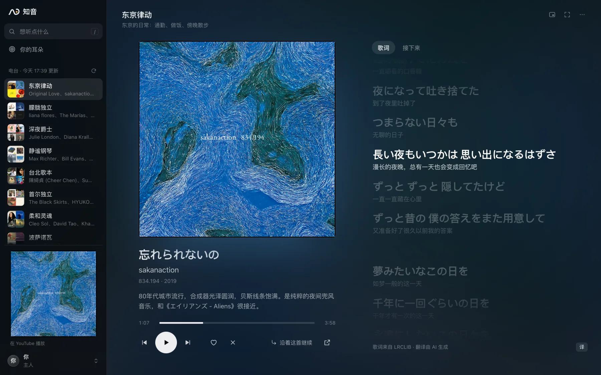
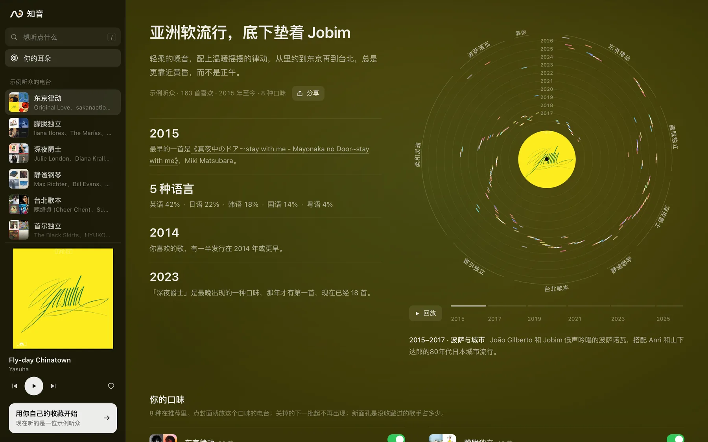
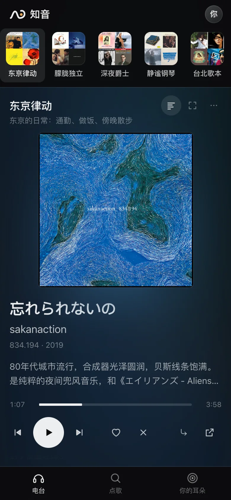
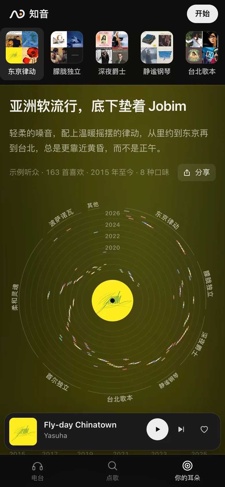

<p align="center">
  <picture>
    <source media="(prefers-color-scheme: dark)" srcset="docs/brand/wordmark-zh-on-dark.svg">
    
  </picture>
</p>

<p align="center">
  从你在 YouTube Music 点过的喜欢出发的私人电台。<br>
  每周给你几个电台的新歌，每一首都告诉你为什么选它。
</p>

<p align="center">
  <a href="https://zhiyin.billpwchan.art/?ref=github"><b>在浏览器里试试</b></a> · 用 Google 登录，或者先听听示例听众的电台
</p>

<p align="center">
  <a href="README.md">English</a> · <b>简体中文</b> · <a href="README.zh-TW.md">繁體中文</a>
</p>

<p align="center">
  <a href="https://github.com/billpwchan/zhiyin/actions/workflows/ci.yml"></a>
  <a href="LICENSE"></a>
</p>

<p align="center">
  
</p>

大多数推荐看的是几百万人在你这首歌后面接着听了什么。结果总是那几首热门，理由也只有一句「因为你听过某某」。

知音只从你自己点过喜欢的那几百首歌出发。你常听的每一类音乐，它先从 YouTube Music 的听歌图谱里找出约 600 首候选，去掉你已经听过的，再把短名单交给 Claude。Claude 像一个把你整个收藏翻过一遍的编辑，只有它打到 0.7 分以上的歌才会放进来。没把握的时候，这个电台就少几首（一首都不够格时只放最好的三首），不拿凑数的填满。

## 用起来是什么样

### 每周一期

大约八个电台，对应你真正在听的几类音乐，每个最多八首，每首附一句为什么。歌通过 YouTube 自己的播放器完整播放，一首放完淡出再接下一首，歌词逐行同步，可以显示翻译和罗马音。

### 用自己的话点歌

「下雨的周日下午」「做饭时听的日语 city pop」，一分钟左右就多出一个电台。

### 边听边调

跳过一首，声音相近的歌在队列里往后排；点喜欢，就往前排。「更安静」「更带劲」「多些新歌手」三个开关按声音重新排这个电台。

### 你的耳朵

把整个收藏画成一张唱片：一圈是一年，一块扇区是一类音乐，还能从第一首喜欢开始把你的口味怎么长出来重放一遍。Claude 给你的口味起一个短短的名字，旁边是它写的一段口味画像。第一次登录时，电台还在准备，唱片几秒内就画出来了；点一下就变成一张能分享的卡片：口味的名字、唱片，和「你喜欢的歌有一半是哪一年或更早的」。

<p align="center">
  
</p>

<p align="center">
  
  &nbsp;&nbsp;
  
</p>

<p align="center"><sub>截图里是一位虚构的听众，收藏取自公开歌单。</sub></p>

界面有简体中文、繁体中文和英文三种，推荐理由和口味画像也用你选的语言写。歌名、歌手和歌词保持原本的语言和字形，繁体歌就按繁体显示。

## 怎么选歌

<p align="center">
  <picture>
    <source media="(prefers-color-scheme: dark)" srcset="docs/images/pipeline-dark.svg">
    
  </picture>
</p>

1. Claude 把你的收藏分成几个电台，每个电台有自己的场景、语言、种子歌和核心歌手。
2. 候选来自 YouTube Music 的电台、相关歌手，以及已经收了你好几首歌的公开歌单。
3. 按图谱打分，留下被你最多种子歌指向的 64 首。
4. 音频模型 [MuQ-MuLan](https://huggingface.co/OpenMuQ/MuQ-MuLan-large) 把你拒绝过的那类声音挡掉。
5. Claude 只留下有把握的几首，并写下理由。

声音只用来否决和调队列，从来不用来排序。拿你后来收藏的歌来检验，单靠声音相似度的 AUC 只有 0.55–0.61，和抛硬币差不多。每一步的细节和踩过的坑见 [How it works](docs/how-it-works.md)（英文）。

|  | 流媒体的电台 | 知音 |
|---|---|---|
| 从哪里出发 | 别人在你这首歌后面接着听什么 | 你点过的喜欢，越近的越重要 |
| 为什么是这首 | 「因为你听过某某」 | 一句只讲这首歌的话，旁边是它最像的你喜欢的那首，可以先放来对比 |
| 没有好歌的时候 | 照样把队列填满 | 少放几首 |
| 你已经听过的歌 | 经常回来 | 过滤掉，现场版、混音、翻唱也一起；听过的不会再推 |

## 运行

需要 Python 3.13、[uv](https://docs.astral.sh/uv/)、一个点过一些喜欢的 YouTube Music 账号，以及 [Claude Code](https://docs.claude.com/en/docs/claude-code)。知音通过 `claude` 命令调用 Claude：设置 `ANTHROPIC_API_KEY`（平常一天 1–2 美元），或者让这个命令登录你自己的 Claude 订阅。

```sh
git clone https://github.com/billpwchan/zhiyin && cd zhiyin && uv sync
uv run zhiyin auth     # 连接 YouTube Music，会一步步告诉你怎么做
uv run zhiyin setup    # 读收藏、分电台、挑第一期，大约一小时
uv run zhiyin serve    # 打开 http://localhost:8817
```

`uv run zhiyin service install` 让它开机常驻，每周出新一期（早上 05:00）。

想放到服务器上，给自己和几个朋友用，每人用自己的 Google 账号登录，见 [部署到服务器](docs/self-hosting.md)（英文）。每个账号互相独立，收藏、电台和记录都是各自的。

<details>
<summary>快捷键</summary>

| 按键 | |
|---|---|
| <kbd>Space</kbd> | 播放 / 暂停 |
| <kbd>N</kbd> <kbd>P</kbd> | 下一首、上一首 |
| <kbd>←</kbd> <kbd>→</kbd> | 后退、前进 10 秒 |
| <kbd>L</kbd> <kbd>X</kbd> | 喜欢、不要这首 |
| <kbd>1</kbd>–<kbd>9</kbd> | 切换电台 |
| <kbd>/</kbd> | 点歌 |
| <kbd>G</kbd> | 歌词；<kbd>T</kbd> 翻译，<kbd>R</kbd> 罗马音，<kbd>[</kbd> <kbd>]</kbd> 微调时间 |
| <kbd>F</kbd> | 沉浸模式，只留封面和歌词 |
| <kbd>M</kbd> | 小窗 |

</details>

## 隐私

你的收藏、播放记录和电台都存在运行它的那台机器上。歌名和歌手会发给 Claude 来分电台、挑歌，不会发给这个项目的作者。每个外部服务收到了什么，见 [Privacy](docs/privacy.md)（英文）。

## 为什么叫知音

《列子·汤问》里，伯牙弹琴时心里想着高山，钟子期就说「峨峨兮若泰山」；想着流水，他就说「洋洋兮若江河」。《吕氏春秋》接着写，钟子期死后，伯牙摔了琴、断了弦，再也不弹。从那以后，「知音」就是那个真正听得懂你的人。标识就是那道高山流水的线，最后卷成一只耳朵。

我做它，是因为用过的推荐判断得太机械：听了一首，就再塞给你一堆差不多的。我想要一个把我所有收藏都看过一遍、像朋友一样替我挑歌的东西。

## 致谢

- [ytmusicapi](https://github.com/sigma67/ytmusicapi)：读取 YouTube Music。
- [MuQ-MuLan](https://huggingface.co/OpenMuQ/MuQ-MuLan-large)：听声音。它的权重采用 CC BY-NC 4.0 许可，所以音频相关功能只能用于非商业用途。
- 试听片段来自 Deezer 和 Apple iTunes Search；歌词来自网易云音乐、[LRCLIB](https://lrclib.net) 和 YouTube Music。
- 字标用的是 Inter 和 Noto Sans CJK（SIL Open Font License）。
- [设计规范](docs/design.md) 记录了界面的规则和它们的来源。

知音与 YouTube、Google、Anthropic 均无关联。

## 许可

[MIT](LICENSE)
