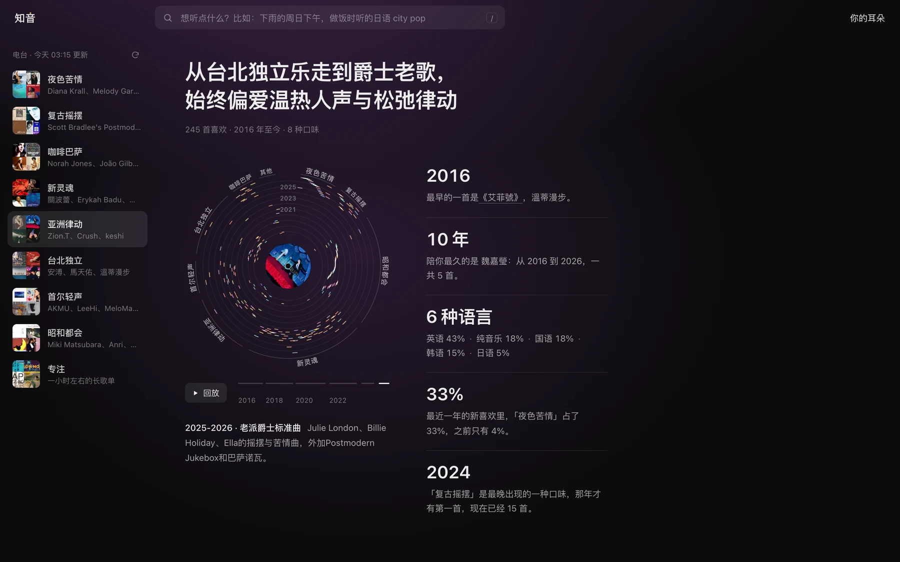
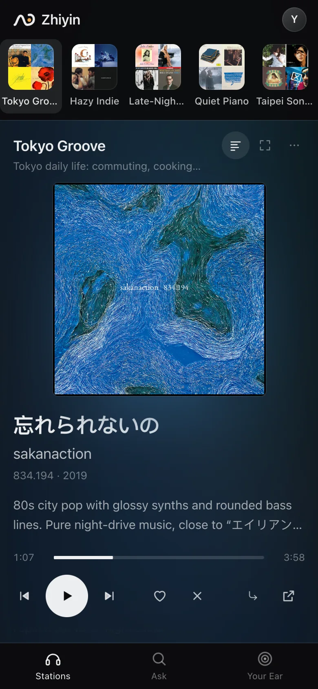
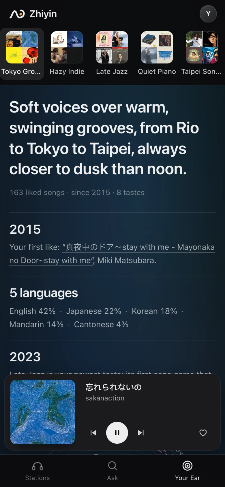

<p align="center">
  <picture>
    <source media="(prefers-color-scheme: dark)" srcset="docs/brand/wordmark-on-dark.svg">
    
  </picture>
</p>

<p align="center">
  读你在 YouTube Music 里收藏的歌，每天早上给你一期第一次听就可能喜欢的新歌。
</p>

<p align="center">
  <a href="https://github.com/billpwchan/zhiyin/actions/workflows/ci.yml"></a>
  <a href="LICENSE"></a>
  
  <a href="README.md">English</a>
</p>

<p align="center">
  
</p>

流媒体的推荐来自几百万人在听什么。知音只从你自己收藏的那几百首歌出发，而且只留下有把握的。

## 它做什么

- **每天一期。** 大约八个电台，对应你真正在听的几类音乐。每个电台最多八首，每首附一句为什么。编辑没把握的时候，这个电台就少几首，不拿凑数的补。
- **好用的播放器。** 通过 YouTube 官方嵌入播放器放完整的歌：交叉淡入淡出、逐行同步歌词（可显示翻译和罗马音）、浮动小窗（Chrome）、媒体键和全键盘操作。
- **用自己的话点歌。** 「下雨的周日下午」「做饭时听的日语 city pop」。
- **边听边调。** 跳过一首，声音相近的歌在队列里往后排；点喜欢，就往前排。部署在服务器上时，你点的喜欢会同步回 YouTube Music。
- **你的耳朵。** 把整个收藏画成一张图：每首歌什么时候收藏、属于哪个电台，再配一段文字写你的口味。

<p align="center">
  
</p>

<p align="center">
  
  &nbsp;&nbsp;
  
</p>

界面是中文的。歌名、歌手和歌词保持原本的语言和字形（繁体歌按繁体显示）。

## 怎么选歌

每个电台先从 YouTube Music 的听歌图谱里找约 600 首候选，去掉你已经知道的，按图谱分留下 64 首，再由音频模型否决你拒绝过的那类声音。最后 Claude 像一个熟悉你收藏的编辑，只留下它有把握的几首。

<p align="center">
  <picture>
    <source media="(prefers-color-scheme: dark)" srcset="docs/images/pipeline-dark.svg">
    
  </picture>
</p>

声音只用来否决和调队列，不用来排序：用你后来收藏的歌检验，单靠声音相似度几乎和抛硬币差不多。每一步的细节和踩过的坑见 [How it works](docs/how-it-works.md)（英文）。

## 在 Mac 上运行

需要 Python 3.13、[uv](https://docs.astral.sh/uv/)、一个收藏了一些歌的 YouTube Music 账号，以及登录好的 [Claude Code](https://docs.claude.com/en/docs/claude-code)（Claude 订阅或 API key 都可以）。

```sh
git clone https://github.com/billpwchan/zhiyin && cd zhiyin
uv sync
uv run zhiyin auth       # 保存 YouTube Music 的请求头，会一步步告诉你怎么做
uv run zhiyin sync       # 读取收藏
uv run zhiyin profile    # 生成电台和口味画像，几分钟
uv run zhiyin listen     # 把每首收藏试听一遍，约一小时，只需一次
uv run zhiyin refresh    # 第一期
uv run zhiyin serve      # 打开 http://localhost:8817
```

`uv run zhiyin service install` 让它开机常驻，每天早上 05:00 出新一期。

想给几个朋友用，每人用自己的 Google 账号登录，见 [部署到服务器](docs/self-hosting.md)（英文）。

<details>
<summary>快捷键</summary>

| 按键 | |
|---|---|
| <kbd>Space</kbd> | 播放 / 暂停 |
| <kbd>N</kbd> <kbd>P</kbd> | 下一首、上一首 |
| <kbd>←</kbd> <kbd>→</kbd> | 后退、前进 10 秒 |
| <kbd>L</kbd> <kbd>X</kbd> | 喜欢、不要这首 |
| <kbd>1</kbd>–<kbd>9</kbd> | 切换电台 |
| <kbd>/</kbd> | 点歌 |
| <kbd>G</kbd> | 歌词；<kbd>T</kbd> 翻译，<kbd>R</kbd> 罗马音，<kbd>[</kbd> <kbd>]</kbd> 微调时间 |
| <kbd>F</kbd> | 沉浸模式，只留封面和歌词 |
| <kbd>M</kbd> | 小窗 |

</details>

## 隐私

所有数据都存在运行它的那台机器上。歌名和歌手会发给 Claude 来生成电台、挑歌；不会发给这个项目的作者。每个外部服务收到什么，见 [Privacy](docs/privacy.md)（英文）。

## 致谢

- [ytmusicapi](https://github.com/sigma67/ytmusicapi)：读取 YouTube Music。
- [MuQ-MuLan](https://huggingface.co/OpenMuQ/MuQ-MuLan-large)：听声音。它的权重采用 CC BY-NC 4.0 许可，所以音频相关功能只能用于非商业用途。
- 试听片段来自 Deezer 和 Apple iTunes Search；歌词来自网易云音乐、[LRCLIB](https://lrclib.net) 和 YouTube Music。
- 标识的字形取自 Noto Sans CJK（SIL Open Font License）。
- [设计规范](docs/design.md) 记录了界面的规则和它们的来源。

知音与 YouTube、Google、Anthropic 均无关联。

## 许可

[MIT](LICENSE)
