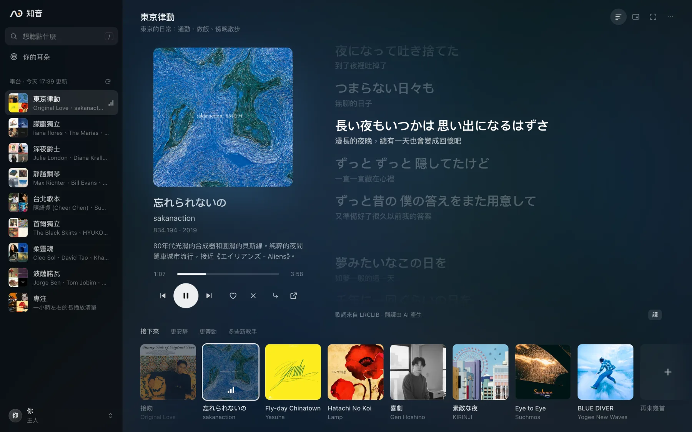
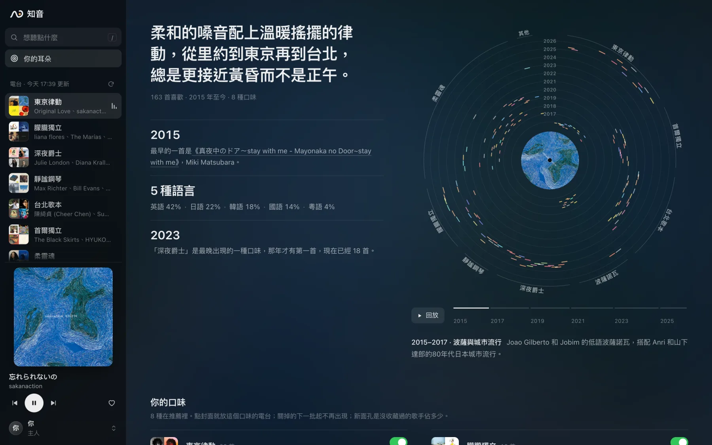
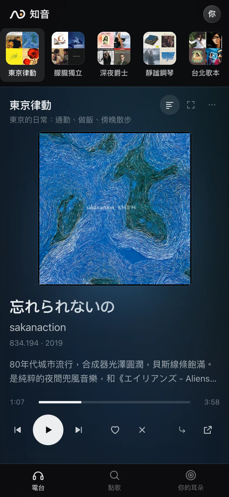
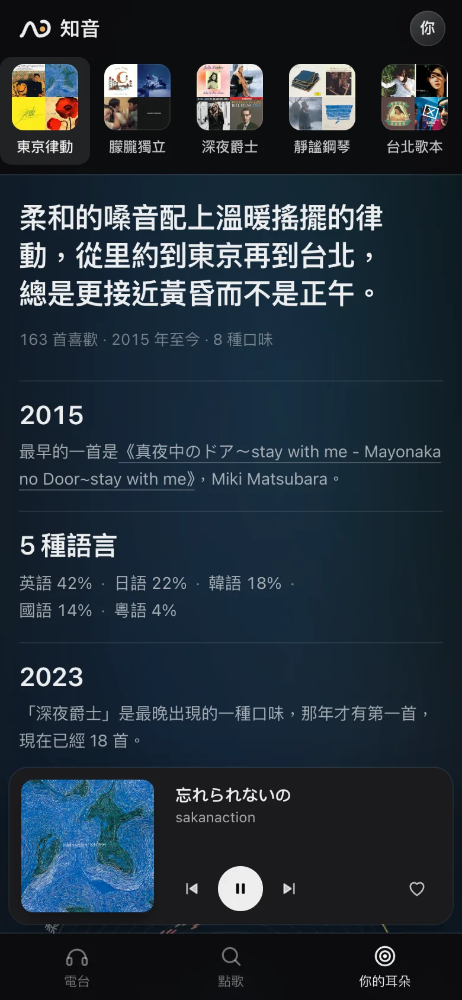

<p align="center">
  <picture>
    <source media="(prefers-color-scheme: dark)" srcset="docs/brand/wordmark-zh-on-dark.svg">
    
  </picture>
</p>

<p align="center">
  從你在 YouTube Music 點過的喜歡出發的私人電台。<br>
  每週給你幾個電台的新歌，每一首都告訴你為什麼選它。
</p>

<p align="center">
  <a href="https://zhiyin.billpwchan.art/?ref=github"><b>在瀏覽器裡試試</b></a> · 用 Google 登入，或先聽聽範例聽眾的電台
</p>

<p align="center">
  <a href="README.md">English</a> · <a href="README.zh-CN.md">简体中文</a> · <b>繁體中文</b>
</p>

<p align="center">
  <a href="https://github.com/billpwchan/zhiyin/actions/workflows/ci.yml"></a>
  <a href="LICENSE"></a>
</p>

<p align="center">
  
</p>

大多數推薦看的是幾百萬人在你這首歌後面接著聽了什麼。結果總是那幾首熱門，理由也只有一句「因為你聽過某某」。

知音只從你自己點過喜歡的那幾百首歌出發。你常聽的每一類音樂，它先從 YouTube Music 的聽歌圖譜裡找出約 600 首候選，去掉你已經聽過的，再把短名單交給 Claude。Claude 像一個把你整個收藏翻過一遍的編輯，只有它給到 0.7 分以上的歌才會放進來。沒把握的時候，這個電台就少幾首（一首都不夠格時只放最好的三首），不拿湊數的填滿。

## 用起來是什麼樣

### 每週一期

大約八個電台，對應你真正在聽的幾類音樂，每個最多八首，每首附一句為什麼。歌通過 YouTube 自己的播放器完整播放，一首放完淡出再接下一首，歌詞逐行同步，可以顯示翻譯和羅馬音。

### 用自己的話點歌

「下雨的週日下午」「做飯時聽的日語 city pop」，一分鐘左右就多出一個電台。

### 邊聽邊調

跳過一首，聲音相近的歌在佇列裡往後排；點喜歡，就往前排。「更安靜」「更帶勁」「多些新歌手」三個開關按聲音重新排這個電台。

### 你的耳朵

把整個收藏畫成一張唱片：一圈是一年，一塊扇區是一類音樂，還能從第一首喜歡開始把你的口味怎麼長出來重放一遍。Claude 給你的口味起一個短短的名字，旁邊是它寫的一段口味畫像。第一次登入時，電台還在準備，唱片幾秒內就畫出來了；點一下就變成一張能分享的卡片：口味的名字、唱片，和「你喜歡的歌有一半是哪一年或更早的」。

<p align="center">
  
</p>

<p align="center">
  
  &nbsp;&nbsp;
  
</p>

<p align="center"><sub>截圖裡是一位虛構的聽眾，收藏取自公開歌單。</sub></p>

介面有簡體中文、繁體中文和英文三種，推薦理由和口味畫像也用你選的語言寫。歌名、歌手和歌詞保持原本的語言和字形，繁體歌就按繁體顯示。

### 喜歡都在網易雲的話

在 [/card](https://zhiyin.billpwchan.art/card) 貼「我喜歡的音樂」的連結，不用登入，十秒出一張唱片。再點「按這些歌，每週幫你挑新歌」，它就成了你的曲庫：Google 只用來確認是你；每首喜歡按歌手、歌名和時長在 YouTube Music 上找同一首（大約五首能找到四首，找不到的也算你已經有的歌），電台和其他人一樣在那裡播放。聽歌排行告訴它哪些舊歌是你的心頭好。播放要能打開 YouTube。

## 怎麼選歌

<p align="center">
  <picture>
    <source media="(prefers-color-scheme: dark)" srcset="docs/images/pipeline-dark.svg">
    
  </picture>
</p>

1. Claude 把你的收藏分成幾個電台，每個電台有自己的場景、語言、種子歌和核心歌手。
2. 候選來自 YouTube Music 的電台、相關歌手，以及已經收了你好幾首歌的公開歌單。
3. 按圖譜評分，留下被你最多種子歌指向的 64 首。
4. 音訊模型 [MuQ-MuLan](https://huggingface.co/OpenMuQ/MuQ-MuLan-large) 把你拒絕過的那類聲音擋掉。
5. Claude 只留下有把握的幾首，並寫下理由。

聲音只用來否決和調佇列，從來不用來排序。拿你後來收藏的歌來檢驗，單靠聲音相似度的 AUC 只有 0.55–0.61，和擲硬幣差不多。每一步的細節和踩過的坑見 [How it works](docs/how-it-works.md)（英文）。

|  | 流媒體的電台 | 知音 |
|---|---|---|
| 從哪裡出發 | 別人在你這首歌後面接著聽什麼 | 你點過的喜歡，越近的越重要 |
| 為什麼是這首 | 「因為你聽過某某」 | 一句只講這首歌的話，旁邊是它最像的你喜歡的那首，可以先放來對比 |
| 沒有好歌的時候 | 照樣把佇列填滿 | 少放幾首 |
| 你已經聽過的歌 | 經常回來 | 過濾掉，現場版、混音、翻唱也一起；聽過的不會再推 |

## 執行

需要 Python 3.13、[uv](https://docs.astral.sh/uv/)、一個點過一些喜歡的 YouTube Music 帳號，以及 [Claude Code](https://docs.claude.com/en/docs/claude-code)。知音透過 `claude` 指令呼叫 Claude：設定 `ANTHROPIC_API_KEY`（平常一天 1–2 美元），或者讓這個指令登入你自己的 Claude 訂閱。

```sh
git clone https://github.com/billpwchan/zhiyin && cd zhiyin && uv sync
uv run zhiyin auth     # 連線 YouTube Music，會一步步告訴你怎麼做
uv run zhiyin setup    # 讀收藏、分電台、挑第一期，大約一小時
uv run zhiyin serve    # 開啟 http://localhost:8817
```

`uv run zhiyin service install` 讓它開機常駐，每週出新一期（早上 05:00）。

想放到伺服器上，給自己和幾個朋友用，每人用自己的 Google 帳號登入，見 [部署到伺服器](docs/self-hosting.md)（英文）。每個帳號互相獨立，收藏、電台和記錄都是各自的。

<details>
<summary>快捷鍵</summary>

| 按鍵 | |
|---|---|
| <kbd>Space</kbd> | 播放 / 暫停 |
| <kbd>N</kbd> <kbd>P</kbd> | 下一首、上一首 |
| <kbd>←</kbd> <kbd>→</kbd> | 後退、前進 10 秒 |
| <kbd>L</kbd> <kbd>X</kbd> | 喜歡、不要這首 |
| <kbd>1</kbd>–<kbd>9</kbd> | 切換電台 |
| <kbd>/</kbd> | 點歌 |
| <kbd>G</kbd> | 歌詞；<kbd>T</kbd> 翻譯，<kbd>R</kbd> 羅馬音，<kbd>[</kbd> <kbd>]</kbd> 微調時間 |
| <kbd>F</kbd> | 沉浸模式，只留封面和歌詞 |
| <kbd>S</kbd> | 寬螢幕的沉浸模式裡只看歌詞，播放器縮到角落 |
| <kbd>M</kbd> | 小窗 |

</details>

## 隱私

你的收藏、播放記錄和電台都存在執行它的那台機器上。歌名和歌手會發給 Claude 來分電台、挑歌，不會發給這個專案的作者。每個外部服務收到了什麼，見 [Privacy](docs/privacy.md)（英文）。

## 為什麼叫知音

《列子·湯問》裡，伯牙彈琴時心裡想著高山，鍾子期就說「峨峨兮若泰山」；想著流水，他就說「洋洋兮若江河」。《呂氏春秋》接著寫，鍾子期死後，伯牙摔了琴、斷了弦，再也不彈。從那以後，「知音」就是那個真正聽得懂你的人。標誌就是那道高山流水的線，最後捲成一隻耳朵。

我做它，是因為用過的推薦判斷得太機械：聽了一首，就再塞給你一堆差不多的。我想要一個把我所有收藏都看過一遍、像朋友一樣替我挑歌的東西。

## 致謝

- [ytmusicapi](https://github.com/sigma67/ytmusicapi)：讀取 YouTube Music。
- [MuQ-MuLan](https://huggingface.co/OpenMuQ/MuQ-MuLan-large)：聽聲音。它的權重採用 CC BY-NC 4.0 授權，所以音訊相關功能只能用於非商業用途。
- 試聽片段來自 Deezer 和 Apple iTunes Search；歌詞來自網易雲音樂、[LRCLIB](https://lrclib.net) 和 YouTube Music。
- 字標用的是 Inter 和 Noto Sans CJK（SIL Open Font License）。
- [設計規範](docs/design.md) 記錄了介面的規則和它們的來源。

知音與 YouTube、Google、Anthropic 均無關聯。

## 授權

[MIT](LICENSE)
