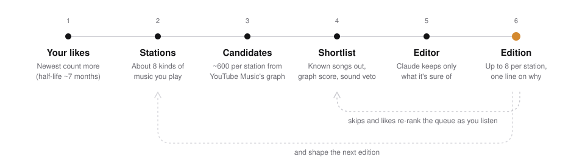

# How Zhiyin picks songs

The short version: YouTube Music's listening graph finds songs, Claude chooses among them like an editor who knows
your library, an audio model keeps out sounds you've turned down, and what you do while listening corrects the
queue as it plays.

The goal is narrow on purpose. A pick is good when you'd like it **on the first listen**. "Sounds similar to your
likes" and "is new to you" both matter less than that.

  <picture>
    <source media="(prefers-color-scheme: dark)" srcset="images/pipeline-dark.svg">
    
  </picture>

## 1. Your likes become stations

Zhiyin reads your liked songs, newest first, so recent taste counts more: a like's weight halves about every
seven months. Claude tags each
song with its language, energy and the moments it suits. Then it groups the library into about eight **stations**,
the kinds of music you actually listen to. For one listener that might be Cantonese R&B, Japanese city-pop groove,
vocal jazz and K-pop girl groups.

Your likes can also come from NetEase Cloud Music or QQ Music: the public "My Liked Music" behind a link you paste,
or the 我喜欢 on a QQ Music profile. Each one is found on YouTube Music by artist, title and length
(`library.match_app`). YouTube Music often spells a Chinese or Japanese artist in Latin letters, so a name in the
other script is checked against its pinyin and the other names the app knows them by (陈奕迅 is also Eason Chan;
华莎 (화사) is also 화사), while a different name in the same script is taken for someone's cover and refused. What is
found becomes your library; what isn't stays out of the stations but is still yours (section 3). NetEase gives the
date you really liked each song, and its 听歌排行 marks your favourites, which then come round more often between the
new songs. QQ Music shows nobody when a song was liked, so for the stations a like's date is estimated: no earlier
than the songs at and below it in the list came out, and within the list's own start and last change. A record made
from a QQ Music link places each song where it came out instead, and says so; its name and roast are written from
those years, never from a guessed like date.

Likes you mark as not your taste (a song a child asked for, a phase, a joke) stay liked but are left out of all
of this: they don't seed stations, define them, or speak for you in the portrait. You can leave out a whole artist
the same way.

Likes aren't the only evidence. A song you keep coming back to without ever pressing ♥ says as much, so Zhiyin
reads how each listen went (`signals.py`), the way Spotify weighs a stream by whether the listener chose the track
([Mehrotra et al. 2021](https://www.gwern.net/doc/reinforcement-learning/exploration/2021-mehrotra.pdf)):

- a song you picked yourself and heard through counts more than one that just played on, and one that played on
  while nobody had touched the page for half an hour counts least;
- repeats on one day saturate; coming back on different days is what makes a song a favourite. Picked and heard
  through on three days, or saved to a playlist of yours this year, is about as strong as a like;
- a song skipped with Next within ten seconds, on its own, is a sound you refused. A run of quick skips is you looking for
  something else right now, and isn't held against the songs in it.

These songs seed their station like likes do (the station they were played from, or the one Claude files them
under), count as positive examples of your sound, and make their artists known rather than new. They are listed on
**Your Ear** under "Played often, never liked", where ♥ adds one to your likes and "Not me" drops it. A Google
Takeout export of your YouTube Music history fills the list on day one: the page reads the file in the browser and
sends only the songs played at least twice, with how many times, on how many days, and when.

With the same read-only access as the likes, Zhiyin also reads, at most once a day, the music you gave a thumbs-down
on YouTube, the music channels you subscribe to, and the songs in playlists you made. The thumbs-down songs are
never recommended and count as refused sounds; playlist songs count as ones you already have; a subscribed artist
with no liked song is someone you know, not a discovery.

The page opens on **Top picks**, a station of the surest songs from all of them, taking turns: every station gives one, the stations you've liked most lately give up to three, and the next song is the one that sounds closest to the last. It holds no songs of its own, so a song heard there doesn't come round again in its own station.

A station is more than a mood. It has a scene, languages and lineage, plus seed songs, core artists, artists worth
exploring, an energy range, things to avoid, and a share of new artists. A soft Mandopop ballad doesn't belong in a
jazz station just because it's quiet.

## 2. Candidates come from the listening graph

For each station, Zhiyin collects about 600 candidates:

- the YouTube Music radio and related songs of each seed;
- similar artists, and the artists the editor suggested exploring;
- artists you subscribe to on YouTube without having liked a song of theirs, when YouTube places them near the
  station;
- releases from the station's core artists in the last two years;
- public playlists that already hold at least two of your likes, or many artists you know. These act as a second
  opinion from someone with overlapping taste. A song found *only* in playlists is dropped, because on its own it brings in popular songs from
  outside the station's scene.

## 3. What you already know is filtered out

- songs you've liked or refused, here or with a thumbs-down on YouTube, and songs in playlists you made; NetEase likes
  count under their NetEase title too, in either Chinese script, including those YouTube Music doesn't have;
- songs you've heard, for good: anything you played to the end, skipped, or left after the first half minute,
  under any of its videos. Pressing play alone doesn't count. Songs played twice or more in an imported YouTube Music
  history count as heard, and so does a song YouTube won't play outside its own site;
- songs from the last two editions, so "another edition" really brings new songs;
- the same song in another form: live, remix, cover, sped-up or lyric uploads, a music video when you liked the
  audio, and uploads that put the artist in the title ("J Tajor & sunkis - Like I Do");
- artists you've blocked or left out of your taste, the wrong language for the station, and long mixes.

Songs that were shown earlier but never played are not used up. They can come back later, behind fresher
candidates of the same strength.

## 4. Narrowing it to a shortlist

This is where most of the songs you'd go on to like used to be lost. On held-out likes, half of them were in a
station's pool of about 600, but only a handful survived into the shortlist.

Each candidate has a graph score: higher the more of your seeds lead to it, the closer it sits to your core artists,
and if it is a recent release. A huge hit by an artist you already follow scores lower, since you've probably heard
it.

On the owner's own accounts (and on a server you run for yourself), Claude then reads the whole pool, up to 700
songs, against every song of yours in the station and how its earlier picks went, and picks the 64 you're most
likely to add on the first listen. Its picks and the graph score's order are then taken in turn until there are 64,
because the two keep different songs. Measured on 124 held-out likes (`zhiyin eval-screen`: six rolling windows over
two accounts, each window's pools rebuilt from the likes older than it), the graph's top 64 kept 45 and Opus's read
alone 46, while the two taken in turn kept 56 to 59 over three separate reads. Reading the list three times and
merging the reads kept no more than one read, so Claude reads it once. Listeners on the shared key get Sonnet's read
taken in turn with the graph the same way (54 against 45; Sonnet's read alone did no better than the graph, 41),
whenever what is left of their day's Claude allowance covers it. When it doesn't, as when all eight stations are
rebuilt by hand at once, they get the graph score's top 64.

## 5. Sound vetoes, it doesn't choose

A 30-second preview of each candidate goes through [MuQ-MuLan](https://huggingface.co/OpenMuQ/MuQ-MuLan-large),
which puts audio and text in one 512-dimension space. The preview is decoded in memory and thrown away; only the
vector is kept. The vector is used to:

- **veto** near-copies of sounds you refused: "not for me", a thumbs-down on YouTube, or a song left within ten
  seconds on its own;
- **steer while you listen**: a skip pushes similar-sounding songs down the queue, a like pulls them up, and the
  "quieter", "more energy" and "more new artists" switches re-rank by sound;
- **match words to sound** when you ask for "rainy Sunday afternoon".

It is deliberately *not* used to rank. On held-out likes it barely predicts what you'll like: AUC 0.55–0.61, where
0.5 is a coin flip. Every candidate was already found through your taste, so they all sound like you. Letting
sound choose pulled soft ballads into the jazz station.

## 6. An editor keeps the few it is sure of

Claude (Opus) sees the station, every song of yours in it (newest first, with when you liked it), how its earlier
picks went (added to your likes, heard through, skipped within seconds, turned down and why), what you recently
refused, and a shortlist of 40 (32 on the shared key) with mixed new and familiar artists and, where the pool allows,
at most two songs per artist. Each station shows the same verdicts under its name ("the next edition learns from"),
so you can see your reactions being used. It returns up to 12 songs with a confidence
score, one line each, and which of the station's songs each pick is closest to.

Two corrections reach the editor in your own words. "Tell this station…" under Adjust in the queue keeps a sentence such
as "fewer trap drums, more from the nineties", which the screen and the editor follow from then on; "save and repick"
rebuilds that one station right away. After "not for me", "just not in this station" tells the editor the song was
fine but in the wrong place, which is a different lesson from a song you don't want.

The line is about the song only. What the page says about you comes from your data, not from the model: the like a
pick is shown next to (the one the editor named, or the one whose radio turned it up), which you can play and then
hear the pick again, and how many songs by its artist you have. A sentence in the line that still names one of your
songs is dropped when another sentence remains. The instructions put quality and texture first: real songwriting, a voice and production
worth hearing, the original studio recording. Classics are welcome when they fit and you don't have them yet.
Being obscure is never a reason on its own.

Only songs the editor rates 0.7 or higher go out, up to 8 per station. A station with fewer good picks shows fewer;
if none reach 0.7, its best three go out so the station isn't empty.
The rest become the station's reserve, which plays when the queue runs out.

While a listener has heard fewer than 60 of them, each station also carries one **probe**: a song the editor would
not have sent out, placed among the picks at random (never first) and marked in the log. Half the time it is one
the editor rated below 0.7, half the time the best song by the graph alone that the editor passed over. How the
probes fare next to the editor's picks says whether its judgement, and the 0.7 bar, are worth what they cost.

Listeners on the server's API key get Sonnet as their editor. On the same eight shortlists, Sonnet kept 75% of the
songs Opus kept and its reasons read as well, for a third of the price ($0.13 an edition against $0.39). Haiku cost
$0.02 but kept only half of them and mixed Chinese into English reasons, so it isn't used for picking.

## 7. Last touches

- A music video is swapped for the same recording's audio track when YouTube Music has one: no skits or long intros,
  and the cover art shows instead.
- A song appears once per edition, even when it surfaced in two stations or as both a video and a track.
- Chinese titles, artists and lyrics follow the song's own script (Traditional or Simplified, Hong Kong or Taiwan
  forms).

## Checking it

What counts is how picks fare when they play. `zhiyin quality` (and "How the picks fare" on Your Ear) takes the first
time each recommended song played and reports how many were heard through (to the end or 80% of the way, and not
refused) and how many were skipped with Next within ten seconds: overall, by station, by the editor's confidence, for new versus
known artists, by place in the station, and for the probes against the editor's picks. Checks run by the operator
are marked and left out.

`zhiyin eval` hides your newest likes, rebuilds candidates from the older ones and counts how many hidden likes the
engine would have surfaced. `zhiyin eval --audio` measures whether sound alone separates them from the engine's own
candidates. Run both before and after changing the engine, and compare a new edition side by side with one you
trusted.

What we learned the hard way:

- **Burning the best songs.** An early version excluded everything shown in the last 28 days. Every rebuild burned
  the best candidates, and later editions were picked from leftovers.
- **Assuming the listener knows the classics.** Telling the editor to assume the listener already knew the classics
  removed songs they went on to like.
- **Tuning weights didn't help.** Seven variants of the graph score made no difference to recall.
- **Asking the model to name songs adds nothing measurable.** Of 246 songs Opus named for eight stations (and found
  on YouTube Music), one was a held-out like, and the graph had already found it. What the graph misses tends to be
  songs met elsewhere in life (a trend, a show, a phase), which no taste model predicts.
